#  ОТЧЕТ ПО ПРАКТИЧЕСКОЙ РАБОТЕ №4
## 1. Тема: Синтаксический анализ контекстно-свободных языков

    Преподаватель:                  В.Н. Мымликов
    Студент: КИ-24-17/1Б, 032427400 А.И. Дворянцев

### 2. Цель работы
Исследование свойств универсальных алгоритмов синтаксического анализа контекстно-свободных языков (на примере алгоритма Кока-Янгера-Касами).

### Задачи
1. Ознакомиться с теоретическими сведениями о нормальной форме Хомского и универсальных алгоритмах синтаксического анализа.
2. Получить у преподавателя собственный вариант задания с описанием контекстно-свободного языка, распознаваемого алгоритмом Кока-Янгера-Касами.
3. Используя изученные механизмы, определить в системе JFLAP согласно постановке задачи соответствующую КСГ. Определенный таким образом язык должен анализироваться алгоритмом Кока-Янгера-Касами. В случае невозможности создания КСГ это должно доказываться формально.
4. Оформить отчет и представить его на проверку вместе с полученной JFLAP-моделью.

### Вариант задания

Вариант 6. Язык оператора присваивания, в правой части которого задано арифметическое выражение. Элементами выражений являются комплексные числа, имена переменных из одного символа (от a до d), знаки операций и скобки для изменения порядка вычисления подвыражений. Операции (в сторону уменьшения приоритета): отрицание, мультипликативные, аддитивные, присваивание.

Таким образом, язык $L_6$:

- **Оператор присваивания:** `V = выражение`, где `V` - переменная `a`, `b`, `c` или `d`. Присваивание - операция с наименьшим приоритетом и правой ассоциативностью, поэтому допустима цепочка `b=c=...`.
- **Комплексное число** записывается парой `[Re,Im]`, где `Re` и `Im` - непустые последовательности десятичных цифр (комплексное число $x + yi$ записывается как `[x,y]`). Такая запись однозначно отличается от скобочного подвыражения и от знаков операций.
- **Отрицание** - унарный минус (наивысший приоритет, применим повторно: `--a`).
- **Мультипликативные операции:** `*`, `/`. **Аддитивные операции:** `+`, `-`. Обе группы левоассоциативны.
- **Скобки подвыражений - квадратные `[` `]`.** Круглые скобки использовать нельзя: JFLAP резервирует символ `(` (при запуске CYK-анализа выдается ошибка *"Grammar has the ( character, which is reserved"*, поэтому в роли скобок порядка вычислений выступают `[` и `]`. Для различения подвыражения `[a+b]` и комплексного числа `[3,4]` достаточно запятой: внутри подвыражения она не встречается, а в комплексном числе после `[` всегда идет цифра.

Формально: $L_6 = \lbrace$ цепочки, выводимые из $S$ в грамматике $G$ ниже $\rbrace$ над алфавитом $\lbrace a,b,c,d,\ 0\text{-}9,\ =,\ +,\ -,\ *,\ /,\ [,\ ],\ ,\rbrace$.

### 3. Полученная КСГ

Язык контекстно-свободный: приоритеты операций и вложенность скобок задаются стандартной иерархической грамматикой выражений, поэтому построение КСГ возможно.

- S -> `VH`
- H -> `AE` | `AS`
- V -> `a` | `b` | `c` | `d`
- A -> `=`
- E -> `EU` | `EW` | `TX` | `TJ` | `MF` | `OY` | `a` | `b` | `c` | `d`
- T -> `TX` | `TJ` | `MF` | `OY` | `a` | `b` | `c` | `d`
- F -> `MF` | `OY` | `a` | `b` | `c` | `d`
- U -> `PT`
- W -> `MT`
- X -> `LF`
- J -> `KF`
- P -> `+`
- M -> `-`
- L -> `*`
- K -> `/`
- O -> `[`
- Z -> `]`
- G -> `,`
- Y -> `EZ` | `NR`
- R -> `GQ`
- Q -> `NZ`
- N -> `0` | `1` | `2` | `3` | `4` | `5` | `6` | `7` | `8` | `9` | `DN`
- D -> `0` | `1` | `2` | `3` | `4` | `5` | `6` | `7` | `8` | `9`

Назначение нетерминалов:

- `S` - оператор присваивания (`V H`)
- `H` - "хвост" оператора: `= выражение` или `= оператор` (цепочка присваиваний)
- `V` - переменная `a`-`d`
- `E`, `T`, `F` - аддитивное выражение, терм, множитель (каждый содержит и "простые" правые части `a`-`d`, `[..]`)
- `U` / `W` - `+ T` / `- T` (продолжение аддитивного выражения)
- `X` / `J` - `* F` / `/ F` (продолжение терма)
- `Y` - остаток после `[`: либо `E ]`, либо `N , N ]`
- `R`, `Q` - остаток комплексного числа: `, N ]` и `N ]`
- `N`, `D` - число (непустая последовательность цифр) и цифра
- `A`, `P`, `M`, `L`, `K`, `O`, `Z`, `G` - терминалы `=`, `+`, `-`, `*`, `/`, `[`, `]`, `,`

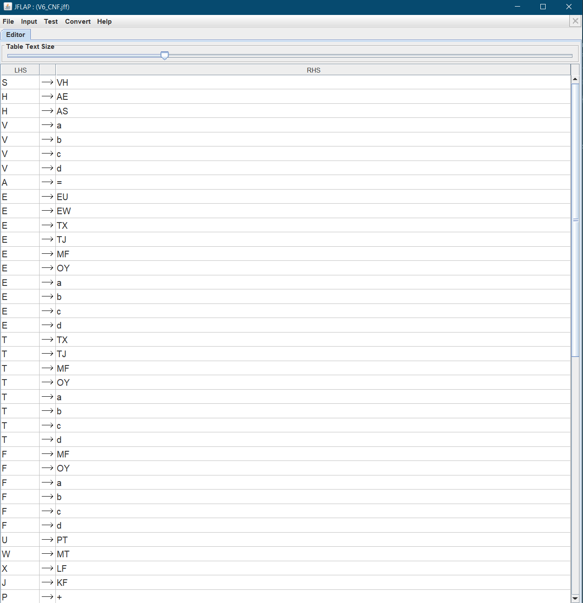
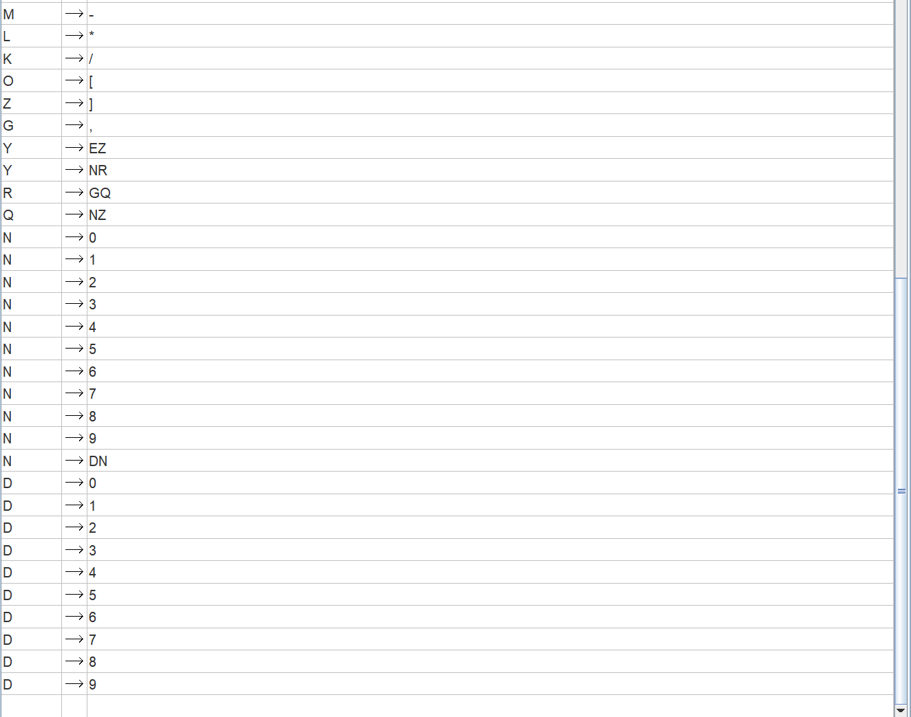

*КСГ в НФХ в JFLAP (файл V6_CNF.jff)*

### 4. Перехваты экранов распознавания тестовых цепочек

1. `a=b+c` - простейшее присваивание, аддитивная операция; результат: принята
2. `d=-a*b` - отрицание приоритетнее умножения; результат: принята
3. `a=[3,4]+b` - комплексное число в выражении; результат: принята
4. `d=[[a-b]*c]` - вложенные скобки; результат: принята
5. `d=[10,25]-a` - многозначные компоненты комплексного числа; результат: принята
6. `a=b+` - нет правого операнда; результат: отвергнута
7. `a+b=c` - присваивание не переменной; результат: отвергнута
8. `a=[3,]` - нет мнимой части; результат: отвергнута
9. `a=b*/c` - две операции подряд; результат: отвергнута
10. `a=[b+c` - нарушен баланс скобок; результат: отвергнута

#### Перехваты экранов JFLAP

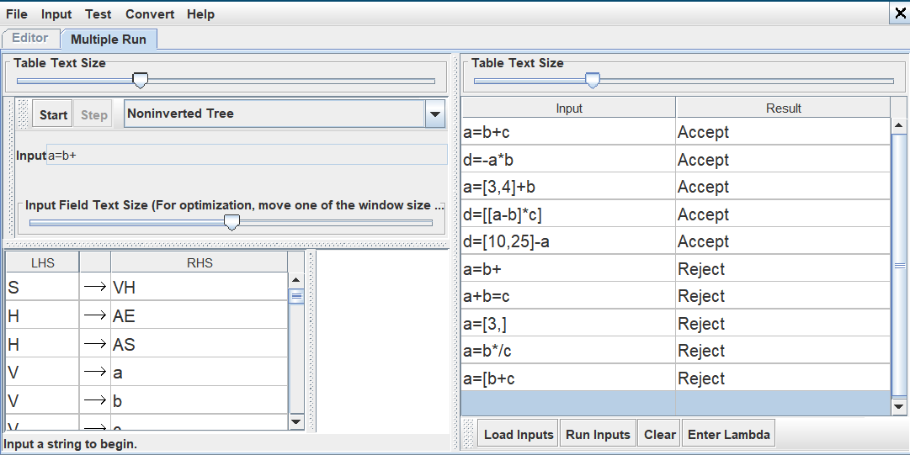

*Распознавания 10 тестовых цепочек*

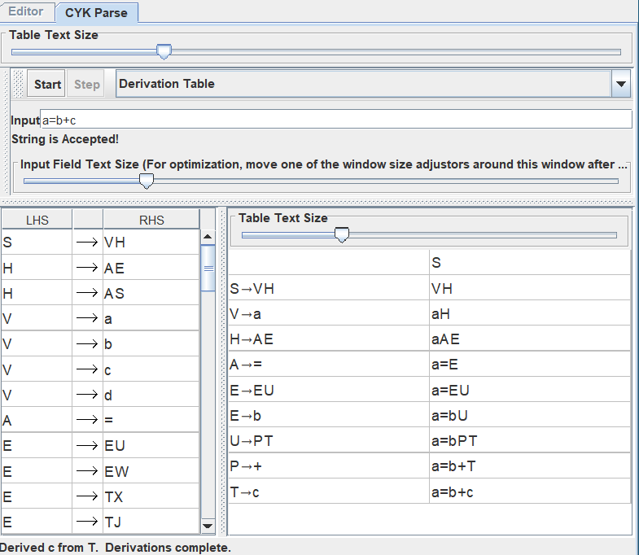

*Цепочка a=b+c - принята*

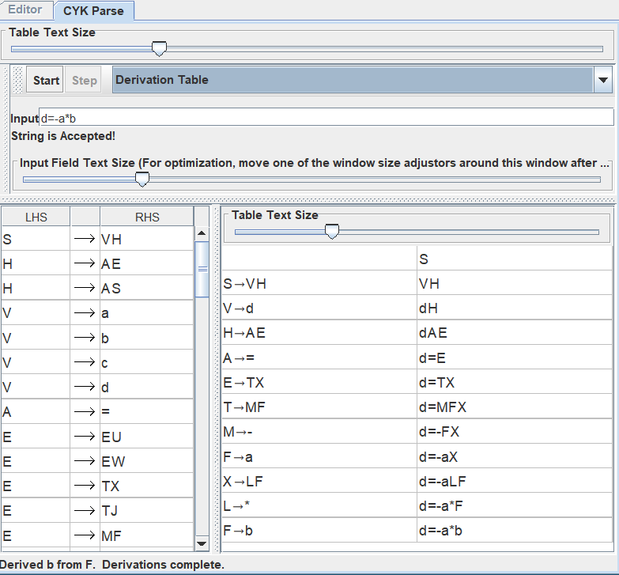

*Цепочка d=-a\*b - принята*

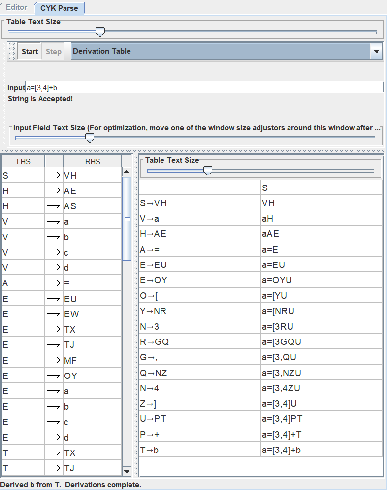

*Цепочка a=[3,4]+b - принята*

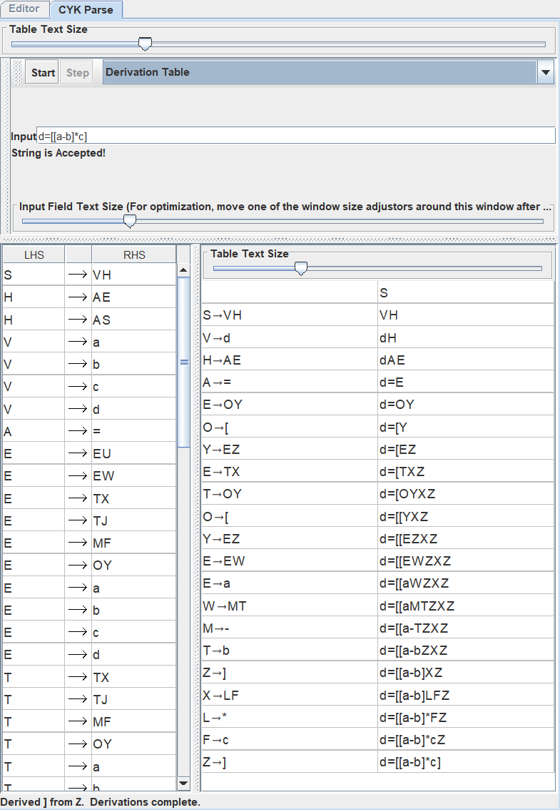

*Цепочка d=[[a-b]\*c] - принята*

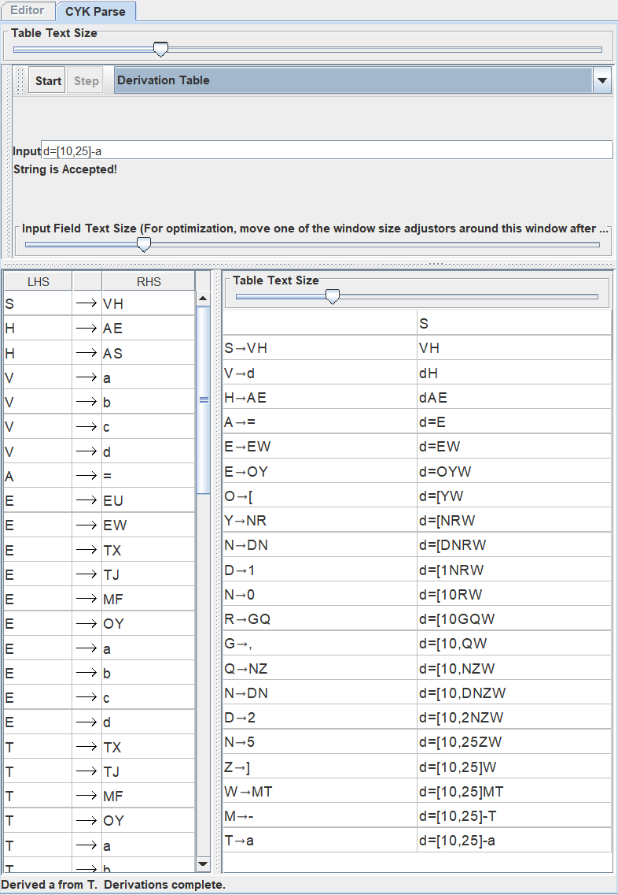

*Цепочка d=[10,25]-a - принята*

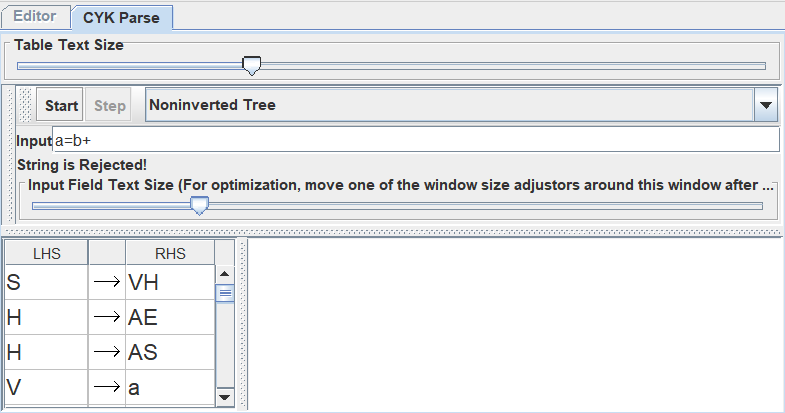

*Цепочка a=b+ - отвергнута*

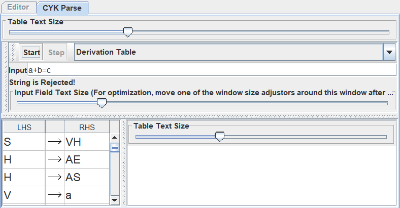

*Цепочка a+b=c - отвергнута*

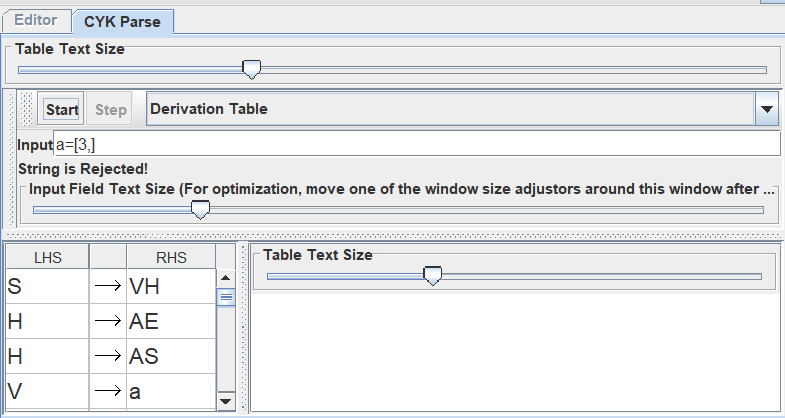

*Цепочка a=[3,] - отвергнута*

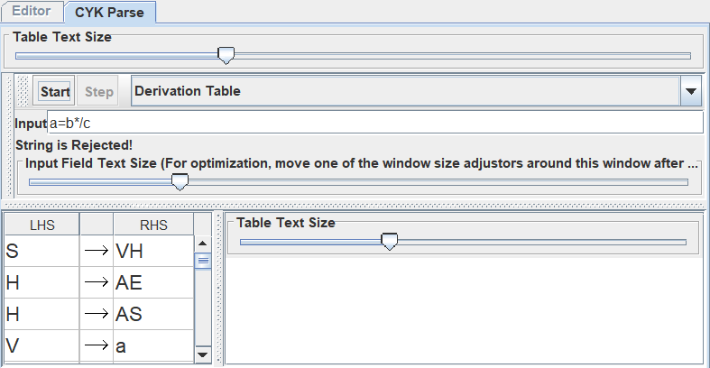

*Цепочка a=b\*/c - отвергнута*

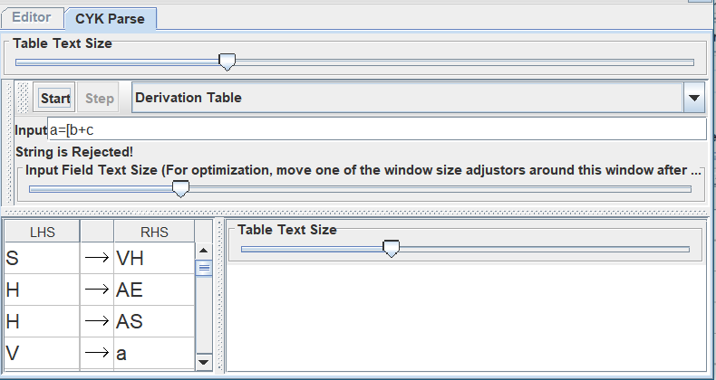

*Цепочка a=[b+c - отвергнута*
